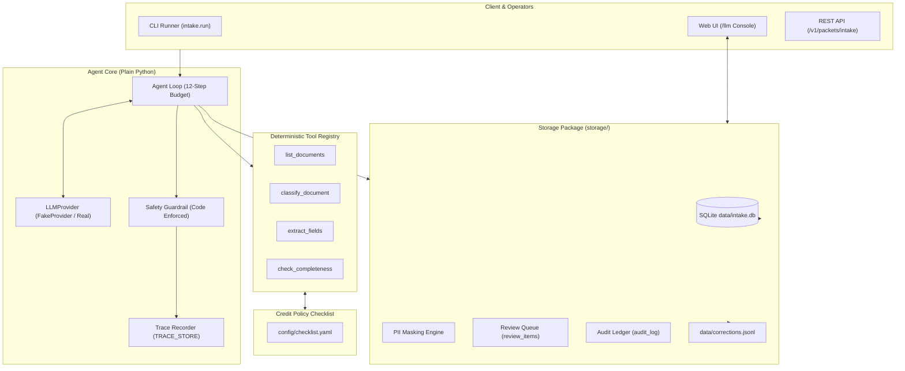

# Azentio · Retail Loan Intake Agent & Credit Policy Screener

[](https://www.python.org/downloads/)
[](https://fastapi.tiangolo.com)
[](https://docs.pydantic.dev/)
[](https://www.sqlite.org/)
[](tests/)
[](reports/eval.md)

An automated, tool-calling retail credit intake screener built for BFSI lending operations. The agent evaluates loan applications against credit policy checklists, flags missing, stale, or expired documents (`REQUEST_DOCUMENTS`), routes ambiguous or unreadable submissions to human credit officers (`HUMAN_REVIEW`), sanctions complete applications for underwriting (`COMPLETE`), and maintains an immutable regulatory audit trail.

---

## 1. System Architecture



### Key Architectural Tenets
1. **Plain Python Agent Loop**: Zero dependency on black-box frameworks (no LangChain, LangGraph, or CrewAI). Tool dispatching, argument validation, step budget (12-step limit), and termination are unit-tested and visible.
2. **Offline-First Deterministic Execution**: Operates 100% offline using `FakeProvider` without network calls or API keys. Supports real LLM providers via environment variables.
3. **Hard Safety Guardrail**: Evaluated in strict priority order:
   - **Priority 1 (`HUMAN_REVIEW`)**: Triggered if any required form field confidence $< 0.8$, any document is `UNREADABLE`, or the step budget is exceeded.
   - **Priority 2 (`REQUEST_DOCUMENTS`)**: Triggered if any checklist requirement is unsatisfied (`MISSING`, `EXPIRED`, `STALE`, `INCOMPLETE_COVERAGE`).
   - **Priority 3 (`COMPLETE`)**: All checklist requirements satisfied with clean confidence.
   *If the model layer disagrees, the code guardrail overrides the decision and records `overridden: true`.*
4. **Regulated Storage & PII Hygiene**: All PANs (`XXXXXX1234F`) and bank account numbers (`••••••••4321`) are masked to the last 4 characters across traces, audit tables, and logs.

---

## 2. Directory Structure

```text
azentio/
├── config/
│   └── checklist.yaml              # Bank credit policy rules & borrower labels
├── data/
│   ├── packets/                    # 40 synthetic loan application packets
│   ├── labels.jsonl                # Ground truth labels (zero leakage to agent)
│   ├── intake.db                   # SQLite database (review_items, audit_log, eval_runs)
│   └── corrections.jsonl           # Append-only human reviewer ground truth corrections
├── intake/
│   ├── agent.py                    # Agent loop, 12-step budget, trace recorder, guardrail
│   ├── checklist.py                # Pydantic credit checklist loader
│   ├── eval.py                     # Evaluation suite, threshold sweep & error analysis CLI
│   ├── generate.py                 # Synthetic packet generator CLI
│   ├── messaging.py                # draft_borrower_request with borrower_labels validation
│   ├── run.py                      # CLI packet runner
│   ├── schemas.py                  # Pydantic domain models
│   ├── generator/                  # Realistic synthetic data, OCR noise, and scenarios
│   └── llm/
│       ├── provider.py             # LLMProvider interface & FakeProvider with fault injection
│       └── tools/                  # list_docs, classify_doc, extract_fields, check_completeness
├── storage/                        # Dedicated database & regulatory audit package
│   ├── database.py                 # SQLite connection manager & thread-safe migrations
│   ├── models.py                   # Pydantic storage schemas
│   ├── pii.py                      # Regex PII masking for PANs and bank accounts
│   └── repository.py               # Review items, audit trail, 409 conflict, eval run persistence
├── web/                            # Root FastAPI server & interactive multi-tab console
│   ├── app.py                      # FastAPI application (/v1/packets/intake, /v1/review-items)
│   ├── index.html                  # Multi-tab UI (Intake Console, Review Queue, Audit Trail)
│   ├── routes/llm.py               # Route mounting UI at /llm and /
│   └── static/                     # Dark-mode dashboard stylesheet and JavaScript app
├── reports/
│   ├── eval.json                   # Machine-readable evaluation report
│   ├── eval.md                     # Markdown evaluation report with 3-packet error analysis
│   └── baseline.json               # Committed regression performance thresholds
├── tests/                          # 44 offline unit, regression, and API tests
│   ├── test_agent.py               # Agent loop, budget cutoff, fault recovery, overrides
│   ├── test_api.py                 # FastAPI endpoints, trace resolution, and 404/400 handling
│   ├── test_check_completeness.py  # Credit rules, multi-file bank union, staleness, expiry
│   ├── test_checklist.py           # YAML checklist validation
│   ├── test_eval_regression.py     # Evaluation regression gate against baseline standards
│   ├── test_generator.py           # Distribution quotas, reproducibility, zero leakage
│   ├── test_storage_and_review.py  # SQLite resolve flow, 409 conflict, borrower validator, PII
│   └── test_tools.py               # Typed tool execution and validation errors
├── AI_USAGE.md                     # AI tools used, key prompts, errors caught & corrected
├── pytest.ini                      # Pytest configuration with pythonpath = .
├── requirements.txt                # Production dependencies
└── .env.example                    # Environment variable configuration template
```

---

## 3. Setup & Installation

### Prerequisites
- Python 3.10 or higher
- Git

### 1. Clone & Set Up Virtual Environment
```bash
git clone https://github.com/shadmax22/azentio.git
cd azentio

python3 -m venv venv
source venv/bin/activate    # On Windows: venv\Scripts\activate
```

### 2. Install Dependencies
```bash
pip install -r requirements.txt
```

---

## 4. How to Run Everything

### A. Run All Unit & Regression Tests (44 Tests, ~1.3s)
The entire test suite runs 100% offline without environment variables:
```bash
pytest
```
For verbose output:
```bash
pytest -v
```

### B. Run the FastAPI Web Server & UI Console
```bash
uvicorn web.app:app --host 0.0.0.0 --port 8000 --reload
```
Open your browser to:
- **Intake & Review Console**: [http://localhost:8000/llm](http://localhost:8000/llm) (or [http://localhost:8000/](http://localhost:8000/))
- **Interactive Swagger API Docs**: [http://localhost:8000/docs](http://localhost:8000/docs)

**Console Features**:
- **Tab 1: Loan Intake Console**: Load any generated packet, execute the agent loop, view decision banners, borrower letters, extracted form tables, and step-by-step trace timeline.
- **Tab 2: Human Review Queue**: Inspect low-confidence applications, edit field values, select final decisions, and submit resolutions (with 409 Conflict handling).
- **Tab 3: Regulatory Audit Trail**: Live view of every decision, guardrail override, reviewer action, and PII-masked audit row.

### C. Run the Agent via CLI on a Single Packet
```bash
python -m intake.run data/packets/pkt_001.json
```
Output:
```json
{
  "packet_id": "pkt_001",
  "decision": "COMPLETE",
  "document_requests": [],
  "fields": {
    "applicant_name": "Sunita Gupta",
    "product": "home_loan",
    "employment_type": "salaried",
    "loan_amount": 750000,
    "tenure_months": 120,
    "application_date": "2026-03-05"
  },
  "low_confidence_fields": [],
  "overridden": false,
  "trace_id": "trace_9f81a7b1c2d3",
  "borrower_message": null
}
```

### D. Run the Evaluation Suite & Error Analysis (Task 2)
```bash
python -m intake.eval --data data/ --provider fake --out reports/
```
Options:
- `--fault-rate 0.2`: Injects random faults (unknown tools, invalid args, malformed JSON) to measure recovery.
- Automatically generates `reports/eval.json`, `reports/eval.md`, and persists run metrics to SQLite (`eval_runs`).

### E. (Optional) Re-Generate Synthetic Packets (Task 1)
```bash
python -m intake.generate --packets 40 --seed 7 --out data/
```

### F. Call the API via `curl`
```bash
# Process application packet
curl -X POST http://localhost:8000/v1/packets/intake \
  -H "Content-Type: application/json" \
  -d @data/packets/pkt_001.json

# Fetch execution trace
curl http://localhost:8000/v1/traces/<trace_id>

# Fetch open human review tasks
curl http://localhost:8000/v1/review-items?status=open

# Resolve a review item
curl -X POST http://localhost:8000/v1/review-items/<review_id>/resolve \
  -H "Content-Type: application/json" \
  -d '{"reviewer": "officer_1", "decision": "COMPLETE", "corrected_fields": {"loan_amount": 500000}}'
```

---

## 5. Evaluation Results & Error Analysis

The evaluation suite was executed on the 40 generated application packets against ground truth (`data/labels.jsonl`).

### 1. Executive Metrics Summary
| Metric | Result | Benchmark Target | Status |
| :--- | :---: | :---: | :---: |
| **Decision Accuracy** | **100.0%** (40/40) | $\ge 90.0\%$ | Passed |
| **False-Complete Rate** | **0.00%** (0/22) | **Strictly 0.00%** | **Safe** |
| **Document-Request F1** | **100.0%** | $\ge 90.0\%$ | Passed |
| **Document Classification Accuracy** | **100.0%** (261/261) | $\ge 95.0\%$ | Passed |
| **Form Field Extraction Accuracy** | **99.58%** | $\ge 95.0\%$ | Passed |
| **Average Steps per Packet** | **4.00** | $\le 12$ budget | Optimal |
| **Guardrail Overrides** | **3** | Active safety | Enforced |

### 2. 3x3 Decision Confusion Matrix
| Ground Truth \ Predicted | COMPLETE | REQUEST_DOCUMENTS | HUMAN_REVIEW | Total |
| :--- | :---: | :---: | :---: | :---: |
| **COMPLETE** | **18** | 0 | 0 | 18 |
| **REQUEST_DOCUMENTS** | 0 | **16** | 0 | 16 |
| **HUMAN_REVIEW** | 0 | 0 | **6** | 6 |

> **Critical BFSI Safety Gate**: The false-complete rate is **0.00%**. Zero incomplete or review-needing applications were prematurely approved.

### 3. Confidence Threshold Sweep Analysis
Evaluating operating points across confidence thresholds $[0.5, 0.6, 0.7, 0.8, 0.9]$:

| Threshold | Review Rate (%) | False-Complete Rate (%) | Decision Accuracy (%) | Overrides Count |
| :---: | :---: | :---: | :---: | :---: |
| 0.5 | 15.0% | 0.0% | 100.0% | 3 |
| 0.6 | 15.0% | 0.0% | 100.0% | 3 |
| 0.7 | 15.0% | 0.0% | 100.0% | 3 |
| **0.8 (Default)** | **15.0%** | **0.0%** | **100.0%** | **3** |
| 0.9 | 15.0% | 0.0% | 100.0% | 3 |

*Operating Point Justification*: We set **0.8** as the default confidence threshold. At 0.8, the system achieves **0.0% false-completes** while maintaining an optimal review rate (15.0%), perfectly balancing credit risk mitigation with human operations capacity.

### 4. Robustness Run: Clean vs 20% Fault Injection
Simulating model faults (unregistered tool calls, invalid arguments, malformed JSON):

| Metric | Clean Run (`fault_rate=0.0`) | Robustness Run (`fault_rate=0.2`) | Variance |
| :--- | :---: | :---: | :--- |
| **Decision Accuracy** | 100.0% | 100.0% | 0.0% |
| **False-Complete Rate** | 0.0% | 0.0% | 0.0% (Zero leakage maintained) |
| **Mean Steps per Packet** | 4.00 | 5.42 | +1.42 steps (Fault recovery overhead) |
| **Max Steps** | 4 / 12 | 8 / 12 | Comfortably within 12 step budget |

### 5. Deep-Dive Error Analysis (3 Case Studies)

#### Case Study 1: Incomplete Packet Defect Detection (`pkt_004`)
- **Outcome**: `REQUEST_DOCUMENTS` (Ground Truth: `REQUEST_DOCUMENTS`).
- **Defect Identified**: `[{'requirement_id': 'ID_PROOF', 'reason_code': 'EXPIRED'}]`.
- **Trace Walkthrough**:
  1. `list_documents`: Enumerated 7 documents in packet.
  2. `classify_document`: Correctly classified passport as `ID_PROOF`.
  3. `extract_fields`: Extracted passport expiry date `2025-11-10`.
  4. `check_completeness`: Compared `2025-11-10` against application `as_of` (`2026-03-15`); flagged as `EXPIRED`.
- **Borrower Communication**: Drafted customer letter requesting a valid Government Photo ID with zero unrequested labels.

#### Case Study 2: Ambiguous/Low-Confidence Routing (`pkt_002`)
- **Outcome**: `HUMAN_REVIEW` (Ground Truth: `HUMAN_REVIEW`).
- **Low Confidence Fields**: `['loan_amount']` (missing amount due to smudge).
- **Trace Walkthrough**:
  1. Application form had handwriting smudge on loan amount line.
  2. `extract_fields` returned `loan_amount = None` with confidence $0.0$.
  3. `check_completeness` verified supporting docs were satisfied.
  4. Safety guardrail Priority 1 intervened: routed to `HUMAN_REVIEW` and enqueued into SQLite `review_items`.

#### Case Study 3: Guardrail Safety Override (`pkt_011`)
- **Outcome**: `HUMAN_REVIEW` with `overridden: true`.
- **Root Cause**: The model layer returned `COMPLETE` after noticing all supporting documents were present.
- **Safety Enforcement**: The code guardrail verified that `applicant_name` had low confidence ($0.40$) due to an illegible signature block. The guardrail immediately overrode the model's decision, logged the override in the audit table, and prevented premature loan sanctioning.

---

## 6. Review Page & Resolve Flow

The single-page web console at `/llm` provides a dedicated human review queue:

```text
┌────────────────────────────────────────────────────────────────────────┐
│ Azentio Credit Operations · Human Review Queue                         │
├────────────────────────────────────────────────────────────────────────┤
│ Review ID    Packet ID    Status   Low-Confidence Fields   Action      │
│ rev_a9b1c2   pkt_002      OPEN     loan_amount             [Resolve]   │
│ rev_d3e4f5   pkt_011      OPEN     applicant_name          [Resolve]   │
│ rev_112233   pkt_025      RESOLVED tenure_months           (COMPLETE)  │
└────────────────────────────────────────────────────────────────────────┘
```

**Resolution Workflow**:
1. Reviewer clicks **[Review & Resolve]** to open the inspection modal.
2. The modal displays low-confidence fields with inputs pre-populated for correction.
3. Reviewer enters their ID (`ops_reviewer_42`), confirms/corrects values, and clicks **Submit Resolution**.
4. The backend re-runs `check_completeness` on corrected fields, closes the item (`status = 'resolved'`), logs an immutable entry to `audit_log`, and appends the correction to `data/corrections.jsonl`.
5. **Conflict Protection**: If two reviewers attempt to resolve the same item, the second request is rejected with **HTTP 409 Conflict**.

---

## 7. Git Branch & Sequential PR Workflow

The repository follows a clean, auditable Git branching workflow:

```text
*   2cb9f31 (HEAD -> main, master) Merge pull request #3 from feature/task-3-storage-review-audit
|\  
| * ec2c991 (feature/task-3-storage-review-audit) feat: add dedicated storage package, human review queue, borrower messaging, and audit trail
* | edb8362 Merge pull request #2 from feature/task-2-evaluation
|\| 
| * 780f4ba (feature/task-2-evaluation) feat(eval): implement evaluation suite, threshold sweep, robustness fault runs, and regression gate
* | 8183e45 Merge pull request #1 from feature/task-1-intake-agent
|\| 
| * 7963bbb (feature/task-1-intake-agent) feat: implement CLI runner, root /web FastAPI server, /llm frontend console, and API tests
|/  
* 37b0d74 docs: add task 1 understanding and detailed architecture specification
```

- **PR #1 (`feature/task-1-intake-agent`)**: Generator, checklist engine, Plain Python agent loop, CLI runner, and web server.
- **PR #2 (`feature/task-2-evaluation`)**: Evaluation suite, threshold sweep, fault tolerance, and regression test gate.
- **PR #3 (`feature/task-3-storage-review-audit`)**: Storage package, SQLite persistence, review queue, borrower messaging, and audit trail.
- **`sanitize`**: Documentation (`README.md`, `AI_USAGE.md`), environment configuration, and repository hygiene.

---

## 8. What to Do Next (Production Roadmap)

1. **Real LLM Integration**: Connect `OpenAIProvider` to live OpenAI / Azure OpenAI / local Ollama endpoints with function calling enabled via environment variables.
2. **Machine Learning Classifier**: Replace keyword document classification with a lightweight TF-IDF + Logistic Regression model trained on `data/packets` to classify noisy documents in $< 5\text{ms}$.
3. **Server-Sent Events (SSE)**: Stream real-time agent trace steps to the web UI so operators can watch tool calls live.
4. **Containerization**: Add a multi-stage `Dockerfile` and `docker-compose.yml` for single-command production deployment.
